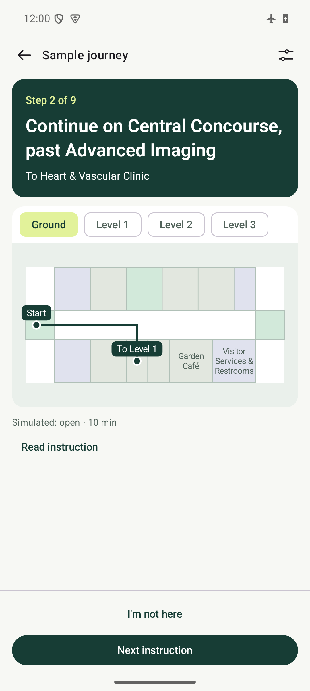

# WAYFORM

WAYFORM is an offline Android wayfinding app for getting from a venue entrance to a specific room. Its survey planner checks which paths have enough measured clearance, slope and step evidence for a visitor’s requirements.

**[Download the Android preview](https://github.com/SanishKumar/wayform/releases/download/v0.1.0-preview.2/wayform-0.1.0-preview.2.apk)** · [Release notes and checksum](https://github.com/SanishKumar/wayform/releases/tag/v0.1.0-preview.2) · [Build from source](docs/android.md)

The public preview runs in airplane mode and uses fictional venues. You can also open a private survey file on the device for a dated route assessment. **Real-world navigation still needs a surveyed venue and a supervised field trial.**

| Search | Preview the route | Follow directions | Compare widths |
| --- | --- | --- | --- |
|  |  |  |  |

## Try it in three minutes

Install the preview APK on an Android 8.0 or newer arm64 phone or x86_64 emulator. You can open the downloaded APK on the device, or use `adb install -r wayform-0.1.0-preview.2.apk`. The preview installs as `app.wayform.preview`. Its bundled examples need no account or network.

If you installed preview 1 from GitHub, uninstall it before installing preview 2. The previews use different development signing certificates. Uninstalling removes saved preferences.

1. **Walk through a sample journey.** In Asterion University Medical Center, search for **cardiology** and open **Heart & Vascular Clinic**. The preview shows the starting place, floor plan and route length. Tap **Start sample journey**, check that the starting place is **Civic Plaza Entrance**, then select **I'm here · Start**. The confirmation describes the simulated conditions. Use **Route options** to change conditions or mobility requirements. Advance through the nine instructions or use **I'm not here** to exercise recovery. Keep the optional hard mobility requirements blank for this legacy sample.
2. **See a measurement change the route.** Return to places and choose **Survey routes → Try the clinic example**. The example opens with a 90 cm width. Tap **75 cm**, **90 cm** or **120 cm** to recalculate immediately. **Edit example requirements** also lets you try zero steps. These example settings are separate from your saved visitor profile.

   | Minimum clear width | Expected result from Plaza entrance to Reception |
   | --- | --- |
   | 75 cm | The 12 m path through the front door qualifies. |
   | 90 cm | The front door measures 82 ± 1 cm. The planner selects the 18 m path through the side lobby. |
   | 120 cm | Both entrances fall below the requirement. The app reports **No eligible path**. |
   | 90 cm plus surveyed zero steps | The example contains only width measurements. The app reports **More evidence needed**. |

3. **Check your own file.** Choose **Open survey file** and select a mobility bundle. The app uses the device clock, the chosen endpoints and your saved requirements. The built-in example uses a fixed time so the results above can be reproduced. [Example JSON](examples/survey/clinic-entrance.json) · [Prepare a venue file](docs/venue-pilot.md)

## How it works

- **Android** uses Kotlin, Jetpack Compose and SQLite. Four bundled venues support offline search, floor maps, written directions, QR or manual check-in and optional offline English speech. Visitors confirm their location and advance instructions themselves. Expired conditions, location recovery and suspension withdraw active guidance. [Android behavior and build](docs/android.md)
- **Rust** owns routing and policy evaluation. The survey planner evaluates directed edges against physical measurements, uncertainty, provenance and freshness. Only eligible edges enter the path search. A result includes the chosen segments and evidence. Missing evidence and an excluded path have separate outcomes. Android calls the same Rust code through UniFFI. [Mobility contract](docs/mobility-contract.md) · [Native route protocol](docs/native-mobility-protocol.md) · [Mobile bindings](docs/mobile-bindings.md)
- **VoiceGIS compatibility** preserves 35 upstream Git blobs at commit `305c70bd418d7fd2b6f0ebf7a2ecd0ddcb9b9b7f`. The migration compares 7,238 complete synthetic route results with the TypeScript reference, including step-free routing, instructions and receipts. The imported source retains its original rights notice. [Compatibility and provenance](docs/compatibility.md) · [Native parity](docs/native-legacy-routes.md) · [Upstream notice](compat/voicegis/upstream/README.md)

## Reproduce the checks

From a clone with Node.js 22.14+ and npm, run the contract tests and the upstream journey audit.

```sh
npm ci --ignore-scripts --no-audit --no-fund
npm run check
npm run compat:audit
```

With the pinned Rust toolchain installed, run the native suite and compare native results with the reference fixtures.

```sh
cargo test --workspace --locked
npm run test:native
```

The Android 15 emulator suite covers offline venue loading, navigation and recovery, policy expiry, survey imports and route changes. To reproduce it, build the native bindings first, connect an arm64 or x86_64 device, then run the following from `apps/android`. The Android guide includes Windows setup and toolchain versions. [Android guide](docs/android.md)

```sh
./gradlew :app:connectedDebugAndroidTest :app:testDebugUnitTest :app:lintDebug
```

[Compatibility CI](https://github.com/SanishKumar/wayform/actions/workflows/quality.yml) · [Android build CI](https://github.com/SanishKumar/wayform/actions/workflows/android.yml)

## Taking it to a real venue

The first field milestone is one operator-approved entrance-to-room journey. It needs a scaled plan, surveyed entrance registration and per-segment measurements, a person responsible for closures, and a supervised trial on physical phones. Survey imports currently support planning. Live guidance for imported surveys still needs map and sign binding and authenticated, expiring operating conditions. [Pilot inputs and field checks](docs/venue-pilot.md)
